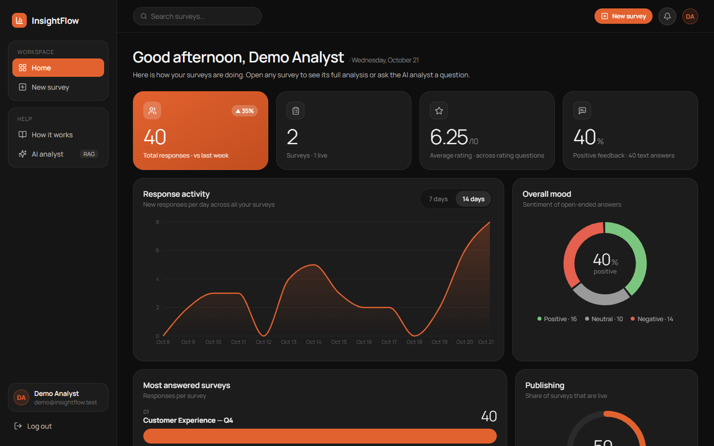
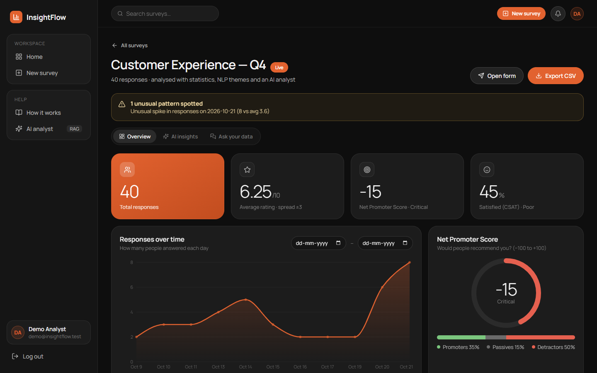
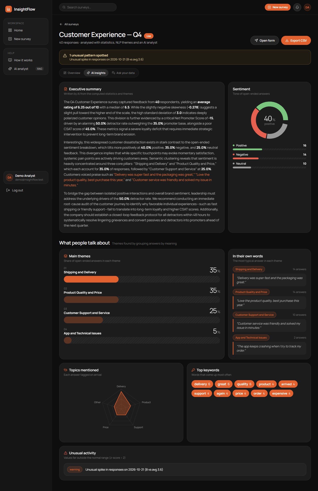
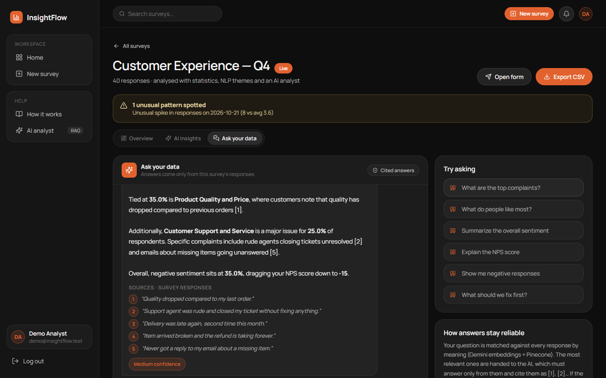
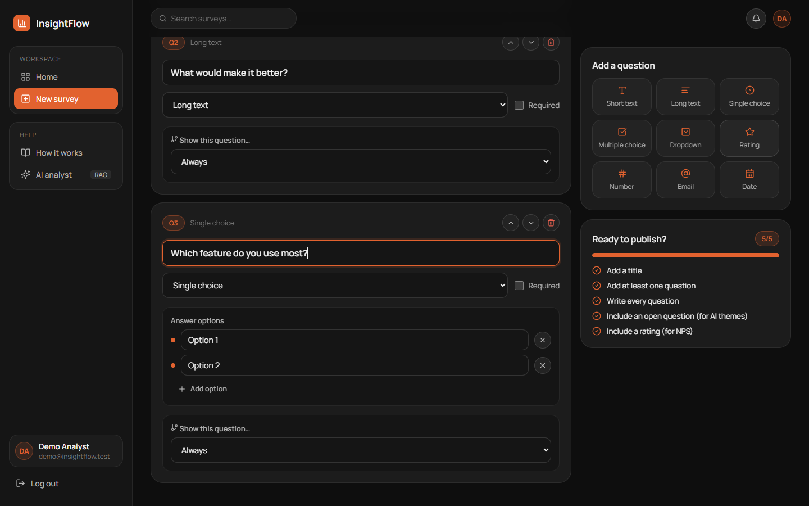
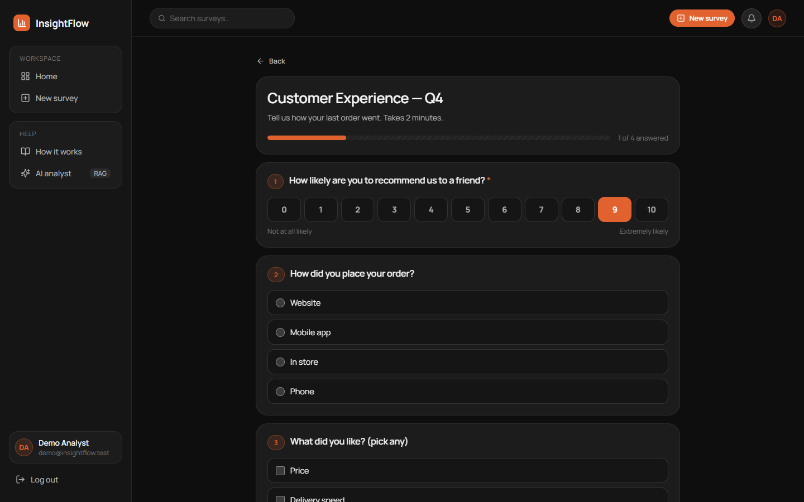
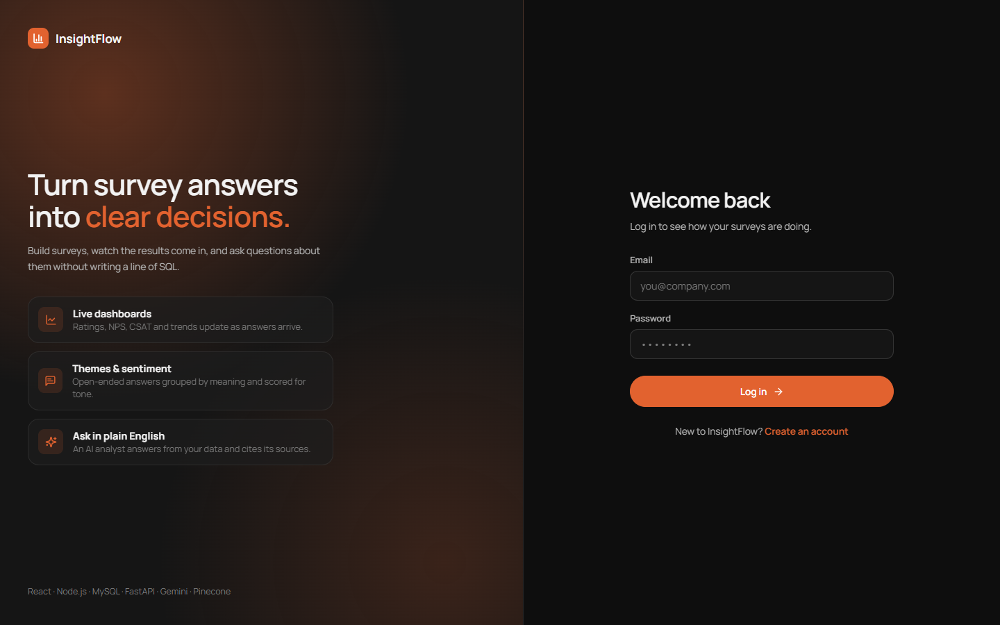
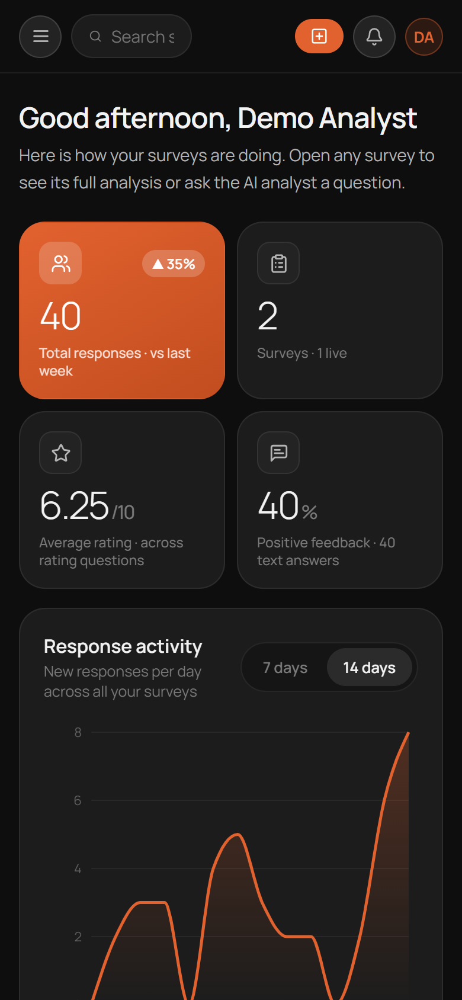

# InsightFlow

**A survey analytics platform where non-technical people ask questions about their data in plain English, and get answers they can check.**

Most survey tools stop at charts. The interesting part, what people actually *wrote*, ends up in a CSV that
someone has to read line by line, or in a SQL query that a business user can't write. InsightFlow tries to close
that gap: build a survey, collect answers, and then simply ask *"What are people unhappy about?"*.

It stores everything in MySQL behind a Node.js API, sends every open-ended answer through a Python NLP microservice
(FastAPI + Gemini) that scores sentiment and groups answers into themes, and puts a RAG agent on top
(Gemini embeddings + Pinecone) that answers questions **only** from the responses and **cites the exact ones it used**.


*The home dashboard for a demo account with 40 responses. Every number is computed live from MySQL; the sentiment
donut comes from the NLP service, which scored each open-ended answer as it arrived.*

## Questions it answers

1. Can a business user get a reliable answer about open-ended feedback without reading every response or writing SQL?
2. Can those answers stay **traceable**, so a wrong answer can be spotted instead of trusted blindly?

## Architecture (short version)

```
                         ┌─────────────────────────── Python AI service (FastAPI :5001) ───────────────────────────┐
 React + Vite  ──REST──> │  Node.js / Express API (:5000) ──> /api/analyze        sentiment (-1..1) + topic       │
 (:5173)                 │        │  JWT auth                 /api/analytics/full  themes · NPS/CSAT · anomalies   │
                         │        │                           /api/analytics/ask   RAG: embed → Pinecone → Gemini  │
                         │        ▼                                                                                │
                         │      MySQL (surveys, questions, responses, ai_insight JSON)                              │
                         └──────────────────────────────────────────────────────────────────────────────────────────┘
```

1. **On submit**, the API stores the answers and sends each open-ended answer to `/api/analyze`; the sentiment
   score, topic and keywords are saved next to the answer as JSON.
2. **On the Insights page**, the API collects all answers and calls `/api/analytics/full`, which groups the text
   into themes, computes NPS / CSAT / distribution statistics, flags anomalies (z-score) and writes an executive summary.
3. **On a question**, `/api/analytics/ask` embeds the answers and the question, retrieves the closest answers from
   Pinecone, and asks Gemini to answer using only those, citing them as `[1]`, `[2]` and so on.

## Stack

| Layer        | Tool |
|--------------|------|
| Frontend     | React 19, Vite, React Router, Recharts, lucide icons |
| API          | Node.js, Express 5, JWT auth, bcrypt |
| Database     | MySQL 8 (`mysql2`), JSON columns for AI insights and question logic |
| AI service   | Python, FastAPI, Uvicorn, Pydantic |
| LLM          | Google Gemini (`gemini-flash-lite-latest` by default, configurable) |
| Embeddings   | Gemini `gemini-embedding-001`, 768 dimensions |
| Vector store | Pinecone (serverless, cosine) |

## What it does

- **Survey builder:** 9 question types (short/long text, single/multiple choice, dropdown, 0–10 rating, number,
  email, date), required fields, number ranges and branch logic ("show this only if Q2 = Yes"). A checklist
  nudges you to add an open question and a rating so the AI insights have something to work with.
- **Sentiment on every answer:** Gemini scores each open-ended answer from -1 to 1 and labels it. If Gemini is
  unavailable, a lexicon fallback with negation handling takes over ("not good" is negative), so submissions never fail.
- **Themes from real assignments:** Gemini names 3–5 themes *and assigns every answer to one*. Counts and percentages
  are then computed in code from those assignments, not estimated by the model, and every quote shown is a verbatim answer.
- **Statistics:** mean, median, quartiles, spread, NPS (promoters / passives / detractors), CSAT and the score distribution,
  plus z-score anomaly detection on scores and daily volume.
- **Ask your data:** a chat where you type a question. The answer cites its sources, the cited answers are listed
  under it, a confidence level comes from retrieval similarity, and if the data can't answer the question it says so.
- **Dashboards:** a cross-survey home page (14-day activity, overall mood, most-answered surveys) and a per-survey
  page with Overview, AI insights and Ask tabs. CSV export.

## Screenshots

| Survey insights | AI insights |
|---|---|
|  |  |
| KPIs, responses over time, NPS split into promoters/passives/detractors, score distribution and a per-question breakdown. | The AI-written summary, sentiment split, themes with their share of answers, and the most typical answer in each theme. |

| Ask your data | Survey builder |
|---|---|
|  |  |
| Questions in plain English. Each answer lists the responses it was built from, so you can check it. | One click per question type, branch logic per question and a publish checklist. |

| Taking a survey | Login | Mobile |
|---|---|---|
|  |  |  |

## Results at a glance

Measured on the demo data (40 responses) with a free-tier Gemini key.

| Question | Result |
|---|---|
| Does sentiment understand negation? | "The delivery was not good at all" → **-0.8, Negative** (the previous keyword matcher called it Positive) |
| Are theme percentages real? | Yes. Every answer is assigned to exactly one theme, and counts come from those assignments; invalid or duplicate ids from the model are dropped and anything unassigned goes to "Other" |
| Does the agent stay grounded? | Asked *"What is our Q3 revenue?"*, it answered that the survey has no revenue data and named what data would be needed |
| Are answers traceable? | Every answer comes with the retrieved responses, numbered to match the `[n]` citations |
| Latency | sentiment ≈ 1–2 s per answer, themes ≈ 2–3 s, a cited answer ≈ 4–12 s |
| Free-tier quota | Embeddings and themes are cached per text, so reloading a page or asking a second question doesn't re-embed every answer |

## Running it

You need Node.js 18+, Python 3.10+, MySQL 8, a [Gemini API key](https://ai.google.dev/) and a
[Pinecone API key](https://www.pinecone.io/) (free tiers work for both).

```bash
# 1. database
mysql -u root -p < backend/schema.sql

# 2. API  (create backend/.env first, see below)
cd backend && npm install && npm start            # http://localhost:5000

# 3. AI service  (create ai_service/.env first, see below)
cd ai_service
python -m venv venv && venv\Scripts\activate      # macOS/Linux: source venv/bin/activate
pip install -r requirements.txt
python app.py                                     # http://localhost:5001

# 4. frontend
cd frontend && npm install && npm run dev         # http://localhost:5173

# 5. optional: demo account with a survey and 40 responses over the last two weeks
cd backend && npm run seed                        # log in as demo@insightflow.test / demo1234
```

**`backend/.env`** (copy `backend/.env.example`)

```env
PORT=5000
DB_HOST=localhost
DB_USER=root
DB_PASSWORD=your_mysql_password
DB_NAME=insightflow
JWT_SECRET=a_long_random_string
```

**`ai_service/.env`** (copy `ai_service/.env.example`)

```env
GEMINI_API_KEY=your_gemini_key
PINECONE_API_KEY=your_pinecone_key
# optional
PINECONE_INDEX_NAME=insightflow-rag
GEMINI_CHAT_MODEL=gemini-flash-lite-latest
GEMINI_EMBED_MODEL=models/gemini-embedding-001
```

| Service      | URL |
|--------------|-----|
| **App**      | **http://localhost:5173** |
| API          | http://localhost:5000 |
| AI service   | http://localhost:5001 (interactive docs at `/docs`) |

## API

| Method | Endpoint | What it does |
|---|---|---|
| `POST` | `/api/auth/register`, `/api/auth/login` | create an account / get a JWT |
| `GET`  | `/api/surveys` | your surveys, with response and question counts |
| `GET`  | `/api/surveys/overview` | cross-survey totals, 14-day trend and sentiment for the dashboard |
| `POST` | `/api/surveys` | create a survey with its questions |
| `GET` / `DELETE` | `/api/surveys/:id` | one survey with its questions / delete it |
| `POST` | `/api/surveys/:id/responses` | submit answers (text answers are analysed on the way in) |
| `GET`  | `/api/surveys/:id/analytics` | KPIs, charts and the full AI analysis |
| `POST` | `/api/surveys/:id/analytics/ask` | ask a question, get a cited answer |
| `GET`  | `/api/surveys/:id/analytics/export` | CSV export |

AI service: `POST /api/analyze` (one answer), `POST /api/analytics/full` (whole survey), `POST /api/analytics/ask` (RAG).

## Project structure

```
backend/      Express API: routes, controllers, MySQL models, schema.sql, scripts/seedDemo.js
ai_service/   FastAPI app + engine/
              ├─ semantic.py    Gemini sentiment, theme assignment, embeddings, Pinecone search
              ├─ rag.py         "Ask your data": retrieval + grounded, cited answers
              ├─ report.py      executive summary
              ├─ statistics.py  NPS, CSAT, descriptive stats, distribution
              └─ anomaly.py     z-score anomalies on scores and daily volume
frontend/     React app: pages/ (Dashboard, Analytics, SurveyBuilder, TakeSurvey, auth),
              components/ (AppLayout, AskYourData, QuestionCard, ui.jsx design system)
docs/img/     screenshots
```

## Project status

**Working end to end:** build → collect → analyse → ask, verified against a live Gemini and Pinecone setup.

**Limits, honestly:**
- Themes are found on the first 300 open-ended answers of a survey.
- Retrieval rebuilds a temporary Pinecone namespace per question rather than keeping a persistent index.
- The free Gemini tier allows about 15 LLM calls a minute. When it runs out, sentiment uses the lexicon fallback
  and answers fall back to templates, still with real numbers but less fluent.
- Ratings use a 0–10 scale so NPS is meaningful; older data entered on a 1–5 scale would read as detractors.
- Branch logic supports one "equals" condition per question.
- There are no automated tests yet.
